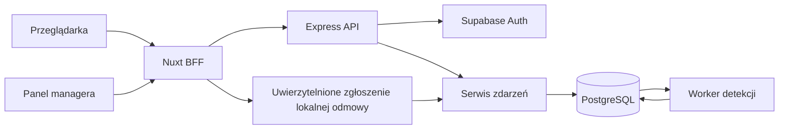

# Dziennik zdarzeń bezpieczeństwa w OSK Manager

Analiza i plan wdrożenia z 18.10.2026, po przeglądzie logiki i bezpieczeństwa. Status: implementacja uruchomiona i sprawdzona lokalnie z bazą DEV; produkcja pozostaje osobnym etapem.

Dodajemy trwały dziennik zdarzeń bezpieczeństwa oraz listę „Logi bezpieczeństwa” pod `/manager/security-logs`, dostępną wyłącznie dla roli `MANAGER`. Manager przegląda zdarzenia swoich OSK. Lista wykorzystuje obecne zaawansowane filtry i wzorzec listy kursantów. Każda odmowa dostępu opisuje konkretną operację, jej wynik i bezpieczny kontekst zasobu.

Dokument obejmuje backend, bazę, Nuxt BFF, frontend, testy i kolejność wdrożenia. Wskazane nowe pliki i nazwy kontraktów opisują plan; dokładne kontrakty należy porównywać z aktualnym kodem.

**Stan na 18.10.2026:** zaimplementowano migrację Prisma, zapis i projekcję zdarzeń, detekcję serii logowań, API managera, podpisane zgłoszenie lokalnych odmów BFF oraz widok listy/szczegółów z filtrami. Migrację `20261018120000_security_events` zastosowano na bazie DEV; test na realnej bazie potwierdził zapis i odczyt w OSK, izolację szkoły, odmowę anonimowego odczytu z nazwą operacji, podpis BFF z deduplikacją, nieudane logowanie i alarm po pięciu próbach. Wpisy syntetyczne z tego testu zostały usunięte. Lokalny BE i FE uruchomione z bazą DEV przeszły ręczny test przeglądarkowy: manager zobaczył logowanie, kursant otrzymał 403 za próbę odczytu dziennika, a wpis `ACCESS_DENIED` z kodem `SECURITY_LOGS_LIST` pojawił się w OSK managera; działały szczegóły, szybki i zaawansowany filtr, zmiana OSK oraz zamaskowane 404 dla nieposiadanej szkoły. Przed uruchomieniem produkcyjnym pozostają: potwierdzenie topologii proxy i IP, wspólne źródło statusu kolektora (API zwraca obecnie `UNKNOWN`), pełne oznaczenie maskowanych 404 w pozostałych usługach, automatyczne pełne E2E na izolowanym środowisku i testy wydajnościowe na danych wielu OSK oraz rollout według sekcji poniżej.

## Ustalenia z istniejącej aplikacji

| Obszar              | Stan obecny                                                                                                                                                               | Wniosek dla wdrożenia                                                                                   |
| ------------------- | ------------------------------------------------------------------------------------------------------------------------------------------------------------------------- | ------------------------------------------------------------------------------------------------------- |
| Logowanie           | `BE/src/controllers/auth/session.handlers.ts`: Supabase `signInWithPassword`, następnie sprawdzanie lokalnego konta i rejestracja sesji                                   | Sukces logować dopiero po przejściu całej ścieżki, nie po samym sukcesie Supabase                       |
| Autoryzacja         | `BE/src/middleware/auth.middleware.ts`: `authMiddleware`, `requireRole`, `requireMinRole`; dodatkowe kontrole w usługach                                                  | Samo dodanie logowania do `requireRole` nie pokryje odmów dostępu do cudzych zasobów                    |
| Błędy usług         | `BE/src/lib/http/AppError.ts` i `errorMiddleware.ts`; część handlerów zwraca błędy bezpośrednio                                                                           | Potrzebne ustrukturyzowane powody odmowy oraz wspólny mechanizm zapisu dla obu ścieżek                  |
| Ukrywanie zasobów   | `managerAccounts.service.ts` zwraca także `404` przy braku dostępu do szkoły/konta                                                                                        | Nie utożsamiać wszystkich odmów z HTTP 403; nie zamieniać wszystkich 404 w incydenty                    |
| Logger              | `BE/src/lib/logger.ts` zapisuje do konsoli i maskuje wybrane klucze                                                                                                       | Dodać oddzielny zapis zdarzeń do bazy; nie kopiować wszystkich logów technicznych do panelu             |
| Rozpoznanie sesji   | `isAccountSessionAllowed` zwraca boolean dla kilku przyczyn, a middleware używa wspólnego komunikatu `SESSION_REVOKED`                                                    | Wewnętrzny kod przyczyny musi odróżniać brak sesji, unieważnienie i trwającą operację na koncie         |
| Zarządzanie kontami | Prisma `AccountAction`: stan procesu, stare/nowe wartości, `requestId`; stany są aktualizowane                                                                            | Zachować mechanizm i emitować z niego zdarzenia. To nie jest gotowy, niezmienny dziennik bezpieczeństwa |
| Powiązania OSK      | Szkoły mają właściciela; migracja `20260911120000_single_school_memberships_and_event_school` wymusza pojedynczą szkołę kursanta/instruktora; manager może posiadać wiele | Przynależność ustala serwer. Logowanie managera bez wybranej OSK wymaga obsługi wielu szkół             |
| BFF                 | `server/utils/upstream/upstreamRequest.ts` przekazuje tokeny/body; nie dodaje automatycznie IP klienta, user-agent i request ID                                           | Uzupełnić kontrolowany kontekst żądania; sprawdzić także osobny `fetch` przy wylogowaniu                |
| Dostęp do widoków   | `app/middleware/manager.ts` korzysta z `hasManagerAccess`, który dopuszcza `ADMIN` i `MANAGER`                                                                            | Dla nowego widoku osobna kontrola dokładnej roli, bez zmiany dostępu do pozostałych stron               |
| Lista i filtry      | `AppAdvancedFilters`, `AppAdvancedFilterSegments` i adaptery kursantów/instruktorów już istnieją                                                                          | Ponownie użyć powłoki, interakcji i wyglądu; dodać domenę filtrów zdarzeń                               |
| Filtrowanie danych  | Lista kursantów przesyła `filters` przez BFF, a BE buduje zapytanie Prisma przed liczeniem i paginacją                                                                    | Zastosować ten sam przepływ dla logów, bez pobierania całej historii do przeglądarki                    |
| Baza                | Repo używa migracji Prisma; istnieje migracja ograniczająca bezpośredni Supabase Data API                                                                                 | Nowe tabele również zamknąć dla `anon`/`authenticated`; sprawdzić rzeczywiste granty i RLS              |

Źródła i wzorce do pracy:

- [Schemat bazy](../../../BE/prisma/schema.prisma), [logowanie i sesje](../../../BE/src/controllers/auth/session.handlers.ts), [kontrola dostępu](../../../BE/src/middleware/auth.middleware.ts).
- [Zarządzanie kontami](../../../BE/src/services/managerAccounts.service.ts), [obsługa błędów](../../../BE/src/lib/http/errorMiddleware.ts), [Prisma i migracje](../../../BE/docs/DATABASE_WORKFLOW.md).
- [Lista kursantów](../app/pages/manager/students/index.vue), [powłoka filtrów](../app/components/app/AppAdvancedFilters.vue), [adapter filtrów instruktorów](../app/components/manager/instructors/ManagerInstructorsAdvancedFilters.vue).
- [Wzorce list UI](UI_COMPONENT_PATTERNS.md), [komponenty](COMPONENTS.md), [kontekst OSK](SCHOOL_CONTEXT.md), [nazewnictwo](NAMING_CONVENTIONS.md).

## Zakres pierwszego wdrożenia

| Zdarzenia                                                                                                            | Kiedy zapisać                                                                                                                                 | Poziom domyślny          |
| -------------------------------------------------------------------------------------------------------------------- | --------------------------------------------------------------------------------------------------------------------------------------------- | ------------------------ |
| `LOGIN_SUCCEEDED`                                                                                                    | Uwierzytelnienie, kontrola konta i lokalna sesja zakończyły się sukcesem                                                                      | Informacja               |
| `LOGIN_FAILED`                                                                                                       | Nieprawidłowe dane logowania; wykonawca pozostaje nieustalony                                                                                 | Ostrzeżenie              |
| `LOGIN_DENIED`                                                                                                       | Konto nieaktywne, zarchiwizowane lub niedostępne mimo poprawnego uwierzytelnienia                                                             | Ostrzeżenie              |
| `LOGIN_PROVIDER_ERROR`                                                                                               | Błąd techniczny dostawcy uwierzytelniania; nie wliczać do błędnych haseł                                                                      | Ostrzeżenie              |
| `LOGIN_RATE_LIMITED`                                                                                                 | Dostawca lub istniejący mechanizm faktycznie ograniczył próbę                                                                                 | Ostrzeżenie              |
| `REPEATED_LOGIN_FAILURES`                                                                                            | Przekroczenie progu zdefiniowanej reguły detekcji                                                                                             | Wysoki                   |
| `LOGOUT_SUCCEEDED`, `LOGOUT_PROVIDER_REVOCATION_FAILED`                                                              | Lokalny stan wylogowania oraz osobno niepowodzenie odwołania sesji dostawcy; usunięcie cookies w BFF nie dowodzi sukcesu BE                   | Informacja / ostrzeżenie |
| `SESSION_REVOKED`, `REVOKED_SESSION_USED`                                                                            | Unieważnienie sesji lub żądanie z wcześniej unieważnioną sesją                                                                                | Informacja / ostrzeżenie |
| `AUTHENTICATION_REQUIRED`, `SESSION_REJECTED`                                                                        | Brak uwierzytelnienia dla chronionej operacji lub odrzucona sesja z powodem, np. `UNKNOWN_SESSION`, `INVALID_TOKEN`, `ACCOUNT_CHANGE_PENDING` | Informacja / ostrzeżenie |
| `SESSION_REFRESH_FAILED`                                                                                             | Nieudane odświeżenie sesji, z odróżnieniem przyczyny technicznej                                                                              | Informacja / ostrzeżenie |
| `ACCESS_DENIED`                                                                                                      | Odmowa roli, uprawnień do szkoły lub konkretnego zasobu                                                                                       | Ostrzeżenie              |
| `PASSWORD_RESET_REQUESTED`, `PASSWORD_RESET_FAILED`, `PASSWORD_CHANGED`                                              | Żądanie odzyskiwania, błąd procesu, faktyczna zmiana hasła                                                                                    | Informacja / ostrzeżenie |
| `PASSWORD_CHANGE_STARTED`, `PASSWORD_CHANGE_COMPLETED`, `PASSWORD_CHANGE_REPAIR_REQUIRED`                            | Rozpoczęcie procesu, ukończenie wszystkich kroków lub potwierdzona zmiana u dostawcy z niedokończonym krokiem lokalnym                        | Informacja / wysoki      |
| `ACCOUNT_CREATED`, `ACCOUNT_BLOCKED`, `ACCOUNT_UNBLOCKED`, `ACCOUNT_ARCHIVED`                                        | Zakończone operacje na koncie, z osobnym wykonawcą i kontem docelowym                                                                         | Informacja               |
| `ACCOUNT_EMAIL_CHANGE_REQUESTED`, `ACCOUNT_EMAIL_CHANGED`, `ACCOUNT_CHANGE_FAILED`, `ACCOUNT_CHANGE_REPAIR_REQUIRED` | Etapy istniejącego procesu zmiany e-maila, bez przedwczesnego sukcesu                                                                         | Informacja / ostrzeżenie |

Próg detekcji nie wprowadza automatycznej blokady kont. Pierwsza wersja ma obserwować i prezentować zdarzenia. Nowa polityka ograniczania logowania, powiadomienia e-mail, eksport CSV, SIEM oraz pełna historia zmian zajęć/płatności pozostają poza zakresem. Limity rozmiaru, czasu i współbieżności pracy samego audytu są jednak częścią wdrożenia. Zmianę roli logować, gdy aplikacja otrzyma obsługiwaną operację zmiany roli; nie dodawać takiej operacji tylko dla dziennika.

Zlecenie resetu nie oznacza potwierdzonego doręczenia e-maila. Zwykłe wygaśnięcie tokenu i automatyczna próba odświeżenia nie oznaczają ataku. Odrzucone wejście na stronę przez middleware Vue jest kontrolą interfejsu; wiarygodny wpis o operacji powstaje przy żądaniu serwerowym, a nie z komunikatu wysłanego przez przeglądarkę.

Klasyfikować wynik po zweryfikowanym kodzie dostawcy i stanie aplikacji, nie po dowolnym tekście błędu lub samym HTTP 401. Brak wpisu `AccountSession` nie jest dowodem wcześniejszego unieważnienia. Wprowadzić wewnętrzny wynik kontroli sesji z kodem przyczyny, zachowując obecne publiczne odpowiedzi. `actorUserId` wolno ustawić dopiero po zweryfikowaniu tokenu lub hasła; samo zdekodowanie JWT nie potwierdza wykonawcy. Nie traktować błędu bazy podczas sprawdzania sesji jak wykrytego ataku.

## Opis operacji przy odmowie dostępu

Każda chroniona operacja otrzymuje stały kod i polską etykietę w katalogu serwera. Przykłady istniejących tras:

| Metoda i trasa BE                         | Proponowany kod          | Tekst w panelu                    |
| ----------------------------------------- | ------------------------ | --------------------------------- |
| `GET /students`                           | `students.list`          | Przeglądanie listy kursantów      |
| `POST /students/:userId/courses`          | `students.assign_course` | Przypisanie kursanta do kursu     |
| `PATCH /manager/accounts/:userId/status`  | `accounts.change_status` | Zmiana statusu konta              |
| `POST /manager/accounts/:userId/archive`  | `accounts.archive`       | Archiwizacja konta                |
| `PATCH /lessons/:id`                      | `lessons.update`         | Edycja lekcji                     |
| `DELETE /vehicles/:id`                    | `vehicles.delete`        | Usunięcie pojazdu                 |
| `GET /manager/security-logs` — nowa trasa | `security_logs.list`     | Przeglądanie logów bezpieczeństwa |

Przykład wpisu widocznego dla managera:

> **Odmowa dostępu — Zmiana statusu konta**. Wykonawca: Jan Kowalski, kursant. Powód: operacja wymaga roli managera. Wynik: odrzucono, HTTP 403. Konto docelowe: identyfikator konta w tej OSK. Szczegóły: czas, IP, metoda PATCH, wzorzec trasy i identyfikator żądania.

Nazwa operacji nie pochodzi z body, query ani nagłówka klienta. Dla statusu konta można dodać zwalidowany zamiar „dezaktywacja” / „aktywacja”; nie przechowywać całego body. Wartości zasobu są opisane jako cel próby, a nie dowód prawa dostępu lub istnienia obiektu.

Plan instrumentacji:

1. Przypiąć statyczne metadane operacji **przed** `authMiddleware` i kontrolą roli. Zachować dotychczasowe guardy. W routerach z globalnym `router.use`, m.in. kont managera, najpierw preferować dopasowanie metadanych przez wspólny katalog tras przed guardem; nie przenosić mechanicznie ochrony na pojedyncze endpointy. Rejestracja tras i katalog korzystają z jednego opisu, z regułami dla parametrów, HEAD oraz metod nieobsługiwanych. Nowy router logów montować przed routerem kont z szerokim guardem lub zawęzić montowanie kont do właściwego prefiksu, zachowując publiczne URL. Test porównuje dostęp każdej zmienionej trasy przed/po, również dla tras niepasujących do routera. Brak metadanych daje ogólne `unknown_operation`, nigdy pominięcie autoryzacji.
2. Uzupełnić kontekst żądania o `operation`, wzorzec trasy, bezpiecznie rozpoznany zasób i kod powodu. Dołożyć typy w `BE/src/types/express.d.ts`.
3. W `requireRole`, `requireMinRole` i kontrolach zasobów korzystać ze wspólnego zapisu odmowy. Dla usług rozszerzyć `AppError` o wewnętrzny kontekst audytu albo wprowadzić wyspecjalizowany `AccessDeniedError` zachowujący obecny status publiczny.
4. Obsłużyć bezpośrednie `sendJsonError` oraz `errorRequestHandler` przez jeden punkt zapisu wyniku, bez automatycznego logowania każdego błędu HTTP. Klucz `source + attemptId + eventPhase` jest unikalny w DB. Dla jednej próby zapisać jeden wynik odmowy; alarm i udokumentowane etapy operacji mogą być osobnymi zdarzeniami. `attemptId` generuje zaufany serwer; dostarczony `x-request-id` służy tylko korelacji. Przekazywane żądanie loguje BE; BFF nie zapisuje powtórnie jego odpowiedzi 401/403.
5. Dla kontroli, które celowo zwracają 404, oznaczać zdarzenie wewnętrznym powodem odmowy, zachowując publiczne 404. Gdy nie można rozróżnić braku zasobu od braku dostępu, opisać „zasób niedostępny”, bez twierdzenia, że zasób istnieje. Zwykłe 404 nie generuje alarmu.
6. Zapis odmowy wykonać poza transakcją, która zostanie wycofana. Same statusy odpowiedzi nie wystarczą do odtworzenia operacji i przyczyny.

Pokrycie obejmuje chronione routery auth, kont, szkół, kursantów, instruktorów, kursów, pojazdów, wydarzeń, lekcji, ocen i harmonogramu. Najpierw katalog i wspólne mechanizmy, następnie oznaczenie rozproszonych kontroli dostępu w usługach. Nie zmieniać przy okazji biznesowych zasad dostępu.

## Widoczność i przypisanie do szkoły

- Odczyt listy i szczegółów wymaga aktywnego, zalogowanego użytkownika o dokładnej roli `MANAGER` oraz własności wybranej aktywnej OSK. `ADMIN` nie otrzymuje dostępu do tego widoku ani endpointu.
- Dostęp sprawdzać przed zapytaniem o logi, ich liczbę i opcje filtrów. Nie wystarcza schowanie pozycji w menu. `schoolId` z klienta jest tylko żądanym kontekstem, nie uprawnieniem.
- Dla operacji biznesowej przypisać szkołę rzeczywistego zasobu ustaloną po stronie serwera. Dla operacji na liście sprawdzić kontekst szkoły. Jeśli istnieje rozbieżność między zasobem a przesłanym `schoolId`, nie przypisywać wpisu na podstawie samego query. Przed uwierzytelnieniem nie wykonywać dodatkowych odczytów cudzych zasobów biznesowych tylko dla audytu. Po ustaleniu wykonawcy można wykorzystać wynik istniejącej kontroli lub ograniczony, indeksowany resolver zwracający wyłącznie ID szkoły; bez ustalenia tego kontekstu wpis jest globalny. Odrębny, ograniczony lookup konta docelowego po nieudanym logowaniu opisano niżej. Nie zmieniać odpowiedzi ani ujawniać istnienia zasobu przez audyt.
- Próba dostępu z OSK A do zasobu OSK B jest zdarzeniem dotyczącym B. Manager B widzi „użytkownik zewnętrzny” i nie otrzymuje nazwiska, e-maila ani identyfikatorów użytkownika z A. Manager A nie otrzymuje szczegółów zasobu B. Nie kopiować takich wpisów automatycznie do szkół wykonawcy.
- Przy logowaniu kursanta/instruktora szkołę ustalać z relacji w bazie. Przy nieudanym logowaniu można rozpoznać **konto docelowe** po znormalizowanym loginie, ale `actorUserId` pozostaje pusty. Nie ujawniać wyniku rozpoznania konta w odpowiedzi logowania.
- Uwierzytelnienie managera bez kontekstu konkretnej OSK może być widoczne w jego aktywnych szkołach, ale tylko jemu. Powiązanie otrzymuje `viewerUserId` równe ID właściciela konta; zmiana właściciela OSK nie udostępnia nowemu właścicielowi osobistej historii logowania poprzednika. Zwykłe zdarzenia biznesowe szkoły mają `viewerUserId = null`. Powiązania zapisać raz w chwili zdarzenia, bez powielania wpisu źródłowego.
- Próby dla nieznanych loginów, adminów bez przypisania oraz nierozpoznawalnych szkół przechowywać jako zdarzenia globalne. Nie pokazywać ich dowolnemu managerowi. Pierwsza wersja nie tworzy globalnego panelu administracyjnego; takie dane pozostają dostępne operacyjnie po stronie serwera/bazy.
- Zmiana szkoły użytkownika nie przepisuje historii do nowej szkoły. Bieżący właściciel szkoły ma dostęp do historii tej szkoły; samo przypisanie osoby obecnie nie daje dostępu do jej dawnych zdarzeń z innych OSK.

### Projekcja danych dla managera

Samo maskowanie danych po pobraniu nie wystarcza: warunek wyszukiwania po ukrytym nazwisku może ujawnić je przez liczbę wyników. `SecurityEventSchool` przechowuje więc **minimalną, niezmienną projekcję** dla tej szkoły, tworzoną razem ze zdarzeniem: `actorVisibility` (`KNOWN`, `UNKNOWN`, `EXTERNAL`), dozwolone ID/etykietę/rolę wykonawcy, dozwolone ID/etykietę celu oraz `viewerUserId`. Dla osoby zewnętrznej identyfikatory, nazwisko i rola są puste; etykieta brzmi „Użytkownik zewnętrzny”. Odrzuconych identyfikatorów nie kopiować do `metadata` ani opisu.

Lista, szczegóły, search, filtry, liczniki i ewentualne opcje wyboru osoby korzystają z **tej samej projekcji**, nie z surowego `SecurityEvent` ani bieżącego profilu użytkownika. Historyczne nazwy nie zmieniają się po zmianie e-maila/nazwiska lub przeniesieniu konta. Opcje filtra osób obejmują wyłącznie projekcje widoczne w wybranej OSK i okresie, również zarchiwizowane konta; mają własną paginację i wyszukiwanie. Nie używać globalnego katalogu użytkowników.

Dla nieznanego lub nieuprawnionego `eventId` zwracać jednakowe 404. Brak uprawnień do szkoły także nie ujawnia, czy szkoła istnieje. Nie zwracać w DTO wewnętrznej listy szkół powiązanych ze zdarzeniem, HMAC loginu, surowych claims ani całego `metadata`.

## Model danych

Proponowane modele Prisma:

| Model                                                  | Odpowiedzialność                                                                                                  |
| ------------------------------------------------------ | ----------------------------------------------------------------------------------------------------------------- |
| `SecurityEvent` → `security_events`                    | Niezmienny wpis zdarzenia, niezależny od bieżącego statusu procesu biznesowego                                    |
| `SecurityEventSchool` → `security_event_schools`       | Powiązania i bezpieczna projekcja dla szkoły; unikalne `(eventId, schoolId)`, opcjonalne zawężenie `viewerUserId` |
| `SecurityDetectionState` → `security_detection_states` | Techniczny stan detekcji i wyciszania powtarzalnych alarmów, oddzielony od historii                               |

Pola `SecurityEvent`:

- `id`, `occurredAt`, `recordedAt` — UUID i czas UTC w `timestamptz`; rozdzielenie czasu zdarzenia od zapisu pozwala później importować dane dostawcy.
- `type`, `category`, `severity`, `outcome`, `reasonCode` — wartości z zamkniętych słowników. Wynik, np. `SUCCESS`, `FAILURE`, `DENIED`, `DETECTED`, jest niezależny od ważności.
- `operationCode`, `operationLabelSnapshot`, `httpMethod`, `routeTemplate`, `httpStatus` — znaczenie operacji i kontekst techniczny. Stabilny kod służy filtrowaniu; etykieta zachowuje czytelność historyczną.
- `actorUserId?`, `actorRoleSnapshot?`, `actorDisplayNameSnapshot?`, `targetUserId?`, `resourceType?`, `resourceId?` — wykonawca i cel osobno. Backend stosuje projekcję danych odpowiednią dla szkoły, również w wyszukiwaniu.
- `loginIdentifierHash?`, `hashKeyVersion?`, `loginIdentifierMasked?` — HMAC z sekretem serwera, nie zwykły skrót e-maila. Znormalizować login zgodnie z faktycznymi zasadami aplikacji/dostawcy; nie usuwać samodzielnie kropek ani sufiksu `+`. Dla rozpoznanego konta detekcja może używać stabilnego ID; HMAC obsługuje nierozpoznane loginy. Rotacja klucza musi zachować korelację przynajmniej przez aktywne okno detekcji albo jawnie zresetować to okno; wersjonowanie zapobiega cichej zmianie znaczenia danych. W panelu wyłącznie maska/projekcja konta.
- `clientIp?`, `ipSource`, `userAgent?` — zwalidowany adres, pochodzenie adresu i ograniczona długość user-agent. Nie przypisywać adresu proxy jako adresu klienta, jeśli nie ma wiarygodnej informacji.
- `requestId?`, `attemptId`, `eventPhase`, `source`, `sourceEventId?`, `accountActionId?`, `metadata` — korelacja i mały JSON z listy dopuszczonych pól. Unikalne `(source, attemptId, eventPhase)`; dla istniejącego procesu konta dodatkowo unikalny klucz jego udokumentowanego przejścia, np. `(accountActionId, eventPhase)`. Retry zapisu nie może powtórzyć operacji biznesowej ani zwiększyć licznika prób. Jeden request może mieć wiele etapów, więc sam `requestId` nie jest kluczem zdarzenia.

Indeksy: `(occurredAt, id)`, `(type, occurredAt)` oraz indeksy detekcji z kluczem korelacji i czasem dla `LOGIN_FAILED`. W projekcji skopiować niezmienny `occurredAt`, co pozwala indeksować listę przez `(schoolId, occurredAt DESC, eventId DESC)` bez sortowania całej historii po joinie. Zdarzenie i projekcje zapisują się atomowo, więc czasy nie mogą się rozjechać. Dodać indeksy do faktycznie wdrożonych filtrów wykonawcy/celu. Zmierzyć `EXPLAIN (ANALYZE, BUFFERS)` dla realnych zapytań i danych wielu OSK; nie tworzyć wszystkich kombinacji indeksów.

Zdarzeń nie aktualizuje się przy zmianie statusu konta. Zamiast aktualizacji powstaje kolejny wpis. Usunięcie konta nie może kaskadowo usuwać historii; preferować identyfikatory historyczne bez FK do użytkownika. Szczególnie `viewerUserId` **nigdy nie może zostać wyzerowany przez `ON DELETE SET NULL`**, bo null oznacza szerszą widoczność dla szkoły. Ten warunek zachowuje historyczne ID także po usunięciu użytkownika. Brak endpointów edycji/usuwania logów. To nie jest kryptograficzna ochrona przed administratorem bazy.

Nowe tabele nie mogą być dostępne bezpośrednio dla Supabase `anon`/`authenticated`. Dla tabel w eksponowanym schemacie włączyć RLS i jawnie sprawdzić granty; Prisma używa uprawnionego połączenia serwerowego, więc **RLS nie zastępuje kontroli OSK w usługach**. Runtime audytu nie ma operacji aktualizowania wpisów; uprawnienia DB w miarę obecnego modelu ról ograniczyć do wymaganych działań. Nie zakładać, że brak przycisku usuwania sam zapewnia niezmienność.

Retencja jest zadaniem operacyjnym. Propozycja: 90 dni od `recordedAt`; osobny okres dla fallbacku w infrastrukturze. Codzienne zadanie serwerowe usuwa wpisy partiami wraz z projekcjami, raportuje wynik i nie usuwa stanu aktywnego okna detekcji. Nie uruchamiać go jako niekontrolowanego timera w każdej instancji API; wyznaczyć pojedynczy scheduler albo blokadę DB. Usunięcie szkoły/konta nie kaskaduje historii; usunięcie samego zdarzenia przez retencję może kaskadować jego projekcje. Zakres retencji obejmuje też zasady wygasania backupów, bez obietnicy natychmiastowego usunięcia ich kopii.

## Zbieranie i wiarygodność danych

Wspólny serwis, np. `recordSecurityEvent`, waliduje dane, stosuje listę dopuszczonych pól, ustala widoczność i zapisuje zdarzenie. Wywołują go handler logowania/recovery, autoryzacja oraz operacje kont. Przeglądarka nie ma endpointu pozwalającego deklarować dowolne zdarzenia bezpieczeństwa.

**Adres i korelacja.** Przejrzeć realny łańcuch reverse proxy → Nuxt → Express. Proxy usuwa/podmienia nagłówki klienta; BFF przekazuje tylko ustalony kontekst. Express ufa wyłącznie skonfigurowanym pośrednikom. Jeśli BE jest publicznie dostępny, metadane BFF muszą być uwierzytelnione albo przekazywane od pośrednika ograniczonego sieciowo. Nie stosować bezwarunkowego `trust proxy = true`. Zewnętrzny `x-forwarded-for` nie może dowolnie zmieniać logowanego IP. Przy braku potwierdzonego adresu zapisać brak i źródło, zamiast pozorować dokładność.

Konfiguracja musi odpowiadać rzeczywistym ścieżkom sieciowym; różna liczba pośredników uniemożliwia bezrefleksyjne zaufanie stałej liczbie hopów. [Dokumentacja Express o proxy](https://expressjs.com/en/guide/behind-proxies/).

**Odmowy w BFF.** Zachować działanie `readAccessToken` i zakończenie żądania w miejscu odmowy. Nie wysyłać dalej oryginalnej operacji ani jej body wyłącznie dla logowania. Dla lokalnie zatrzymanej, rozpoznanej operacji BFF wysyła osobny, minimalny komunikat do `POST /internal/security-events/bff-denial`. Jest to wejście serwer–serwer, bez publicznego adaptera `/api/...`, z uwierzytelnieniem usługi (podpis HMAC całego komunikatu i czasu, osobny sekret, kontrola świeżości) oraz idempotencją po `attemptId`. Sama trudna nazwa URL lub CORS nie są zabezpieczeniem.

Ten endpoint przyjmuje tylko `source = BFF`, dozwolone kody lokalnych odmów i operację z katalogu. Nie przyjmuje dowolnego typu zdarzenia, roli, wykonawcy ani szkoły zadeklarowanych przez przeglądarkę. Pierwsza wersja obsługuje brak sesji przed wywołaniem BE: `actorUserId = null`, zakres globalny. Nieznany kod, nadmierny rozmiar, nieważny podpis lub zbyt stary komunikat są odrzucane. Ponowienie tego samego komunikatu nie dopisuje wpisu; nieprawidłowe wywołania wejścia audytowego trafiają do ograniczonego loggera infrastruktury, aby nie tworzyć rekurencji. Timeout raportowania nie zmienia oryginalnego 401 ani obsługi cookies. Zwykłe anonimowe sprawdzanie `/auth/me`/sesji i nierozpoznane URL nie są raportowane jako incydent domenowy.

**Metadane przed guardem.** Rozpoznanie operacji jest statyczne i nie wymaga dostępu do DB. Katalog opisuje oddzielnie operację i sposób bezpiecznego rozstrzygnięcia zasobu. `security_logs.detail` nie może zwracać treści niedostępnego logu w logu odmowy. Odczyty katalogu, brak metadanych i błędy rejestratora nigdy nie zmieniają decyzji kontroli dostępu.

**Brak sekretów.** Nigdy nie zapisywać hasła, JWT, refresh tokenów, cookie, nagłówka Authorization, linków recovery, całego body ani pełnego URL z query. Do logu trafia wzorzec trasy i wybrane, zwalidowane identyfikatory. Ograniczyć rozmiary pól, obsłużyć znaki sterujące i prezentować tekst bez `v-html`. Te zasady dotyczą także fallbacku do loggera.

**Spójność zapisu.** Zapis surowego zdarzenia i jego projekcji jest atomowy. `AccountAction` pozostaje źródłem przebiegu wieloetapowej operacji Supabase/DB. Nie dublować tej samej zmiany w routerze i usłudze. Rozróżnić następujące polityki, zamiast stosować ogólne „błąd logowania ignorujemy” do wszystkiego:

| Sytuacja                                  | Zachowanie przy błędzie zapisu audytu                                                                                                                                                  |
| ----------------------------------------- | -------------------------------------------------------------------------------------------------------------------------------------------------------------------------------------- |
| Odmowa dostępu, wynik logowania lub sesji | Decyzja pozostaje bez zmian; ograniczony czas zapisu, bezpieczny fallback i mierzalny błąd audytu                                                                                      |
| Lokalna zmiana danych konta w transakcji  | Zdarzenie powstaje w tej samej transakcji; błąd zapisu wycofuje tę zmianę i zwraca błąd operacji. To świadomie silniejsza gwarancja dla operacji administracyjnych                     |
| Zmiana już wykonana w Supabase            | Nie można jej wycofać rollbackiem Prisma. Osobno rejestrować potwierdzony efekt dostawcy i niedokończoną synchronizację; zachować stan naprawy i nie ponawiać ślepo wywołania dostawcy |
| Awaria wyliczania alarmu                  | Zachować wcześniej zapisane zdarzenie źródłowe, oznaczyć zaległość detekcji i ponowić ją; nie gubić próby wraz z alarmem                                                               |

Przy zmianie hasła `PASSWORD_CHANGED` oznacza potwierdzenie dostawcy, `PASSWORD_CHANGE_COMPLETED` zakończenie wszystkich kroków, a `PASSWORD_CHANGE_REPAIR_REQUIRED` nieudane unieważnienie lokalnych sesji po zmianie u dostawcy. Każdy etap ma osobny klucz idempotencji. Po walidacji recovery, przed wywołaniem zmieniającym hasło, zapisać `PASSWORD_CHANGE_STARTED` bez hasła/tokenów. Gdy zapisu nie da się utworzyć, nie zaczynać zmiany u dostawcy. Rozpoczęty proces bez etapu końcowego po ustalonym czasie jest operacyjnie „wynik nieustalony / wymaga sprawdzenia”, a nie „hasło niezmienione”. Operator ma zapytanie wykrywające takie przypadki; brak automatycznego ponawiania zmiany hasła. Nie dodawać nowego silnika workflow ani przerabiać `AccountAction` tylko dla odzyskiwania hasła. Analogicznie sukces lokalnego wylogowania nie potwierdza odwołania sesji Supabase.

**Awaria dziennika.** Rejestrator ma osobny limit czasu zapytania/transakcji i ograniczenie liczby zapisów w toku. Sam `Promise.race` z timeoutem nie zatrzymuje zapytania do DB; zadbać o faktyczne limity po stronie klienta/DB. Nie opierać trwałości na nieoczekiwanej obietnicy ani samym `res.on('finish')`. Fallback zawiera ten sam identyfikator zdarzenia i tylko bezpieczne pola. Mierzyć liczbę nieudanych zapisów, pominięć przy przeciążeniu i opóźnienie detekcji; ustalić miejsce odczytu tych metryk/logów dla operatora. Nie zapisywać błędu rejestratora ponownie przez ten sam rejestrator.

Pierwsza wersja nie gwarantuje zapisu do DB podczas awarii DB. Dane z fallbacku nie pojawiają się automatycznie w panelu. Jeśli system zna okres degradacji, pokazać w panelu neutralny komunikat o możliwej niepełności zbierania; nie oznaczać wtedy braku rekordów jako „brak incydentów”. Status musi pochodzić ze wspólnego dla instancji źródła zdrowia kolektora; jeśli takiego źródła brak lub wygasło, zwrócić `UNKNOWN`, nie wywnioskować `OK` z udanego SELECT. Trwała kolejka i automatyczne odtwarzanie fallbacku są osobnym rozszerzeniem.

**Ochrona przed zalewem logów.** Zwalidować długość loginu i kształt danych przed kosztownym wywołaniem dostawcy/audytu; nie przechowywać dowolnego niepoprawnego body. Ustalić maksymalny rozmiar zdarzenia i metadanych, np. 4 KiB i 1 KiB, limity listy oraz współbieżności zapisów i odbiornika BFF. Przy przeciążeniu nie tworzyć nieograniczonej kolejki w pamięci i nie wyczerpywać puli połączeń aplikacji. Zliczać opuszczone zapisy w ograniczonym kanale operacyjnym. W normalnym obciążeniu zachować każdą przyjętą próbę; podczas degradacji detekcja operuje na dostępnych danych i nie obiecuje pełnych liczników. Wygaszać nieaktywne klucze detekcji, również dla losowych nieznanych loginów. Wielkość limitów dobrać testem obciążeniowym, nie arbitralnym zatrzymaniem historii po osiągnięciu liczby wierszy.

**Cache i transport.** Odpowiedzi listy, szczegółów i opcji filtrów w BE/BFF mają `Cache-Control: private, no-store`. Wykluczyć te trasy z cache Nitro/CDN, współdzielonych kluczy `useAsyncData` i utrwalania do localStorage. Dane SSR nie trafiają do publicznego cache. Każde żądanie ponownie sprawdza rolę, aktywność sesji i własność OSK. Usunięcie danych po zmianie szkoły/wylogowaniu obejmuje listę, dialog, opcje i historię kursorów. Przekazywane w query filtry mogą zawierać IP/ID: nie zapisywać pełnych URL w logach aplikacji/proxy dla tego modułu.

**Pokrycie Supabase.** Bezpośrednie próby do Supabase Auth mogą ominąć Express. Supabase ma własne Auth Audit Logs, a zapis w `auth.audit_log_entries` jest opcjonalny. [Dokumentacja Supabase](https://supabase.com/docs/guides/auth/audit-logs). Pierwsza wersja obejmuje żądania obsłużone przez aplikację. Przed deklarowaniem pełnego pokrycia dostawcy trzeba sprawdzić konfigurację projektu i próbki zdarzeń, szczególnie nieudanych prób; ewentualny importer otrzymuje osobne źródło i deduplikację. Nie udostępniać surowego audytu Supabase managerom.

Zakres rejestrowania, wykluczanie sekretów, ochrona logów i testy awarii są zgodne z kierunkiem [OWASP Logging Cheat Sheet](https://cheatsheetseries.owasp.org/cheatsheets/Logging_Cheat_Sheet.html). Konkretne progi i model widoczności powyżej są decyzjami dla OSK Managera.

## Wykrywanie wielokrotnych prób

Proponowane ustawienia startowe, konfigurowalne po wdrożeniu:

- 5 błędnych prób dla tego samego identyfikatora konta w ruchomym oknie 10 minut, niezależnie od adresu IP.
- 20 błędnych prób z jednego wiarygodnego IP w 10 minut, niezależnie od konta. Wyższy próg uwzględnia współdzielone sieci; sam wspólny adres nie dowodzi ataku.
- Jeden alarm danej reguły i klucza korelacji na 10 minut. Każda próba nadal ma własny wpis; alarm zawiera liczbę prób i zakres czasu. Sukces nie kasuje historii.

Detekcję oprzeć na trwałym stanie w PostgreSQL, nie liczniku procesu Node. Najpierw trwale zapisać próbę i oznaczyć jej klucze korelacji jako wymagające przeliczenia w tej samej krótkiej transakcji. Detekcję wykonuje oddzielny krok roboczy z trwałego stanu; nie trzymać blokady podczas kontaktu z Supabase. API może uruchomić pierwszy przebieg, ale po awarii procesu pracę podejmuje cykliczny worker z DB. Docelowo alarm pojawia się do 5 sekund w normalnych warunkach; panel odświeża się przyciskiem, bez WebSocketów.

`SecurityDetectionState` ma unikalne `(rule, scopeKey, subjectKey, keyVersion)`, jawny zakres zamiast nullable elementu klucza unikalności, numer generacji zgłoszonej i przetworzonej pracy, `nextEligibleAt`, pozycję przetworzonej próby oraz czas ostatniej aktywności. `scopeKey` rozróżnia globalne dane, wspólną projekcję szkoły i projekcję szkoły zawężoną przez `viewerUserId`; nie mieszać prywatnych prób managera z alarmem dostępnym przyszłemu właścicielowi. Tworzenie stanu przez atomowy upsert; transakcja workera blokuje wiersz reguły, liczy **unikalne zapisane próby** w ruchomym oknie, zapisuje alarm i aktualizuje cooldown atomowo. Pracownik oznacza przetworzoną tylko przejętą generację, żeby nie zgubić równoczesnego zgłoszenia. Próby spóźnione i zaległości wymagają przeliczenia okien kończących się w czasie nieprzetworzonych prób, a nie tylko „ostatnich 10 minut od teraz”; alarm ma historyczny czas wykrytego progu i bieżący czas zapisu.

Przy kilku instancjach powstaje jeden alarm na klucz/cooldown. Konflikty i zakleszczenia mają ograniczony retry samej transakcji audytu, z tą samą tożsamością zdarzenia. Nie powtarzać logowania ani zmiany konta. Klucze blokować w stałej kolejności. Ponowione dostarczenie tej samej próby nie zwiększa licznika. Czas próby jest czasem serwera; dla okna 10 minut użyć `(t - 10 minut, t]`, próg `>=`, a kolejny alarm dopiero po cooldownie i co najmniej jednej nowej próbie. Udane logowanie nie zeruje licznika błędów.

Reguła konta/IP ma osobne klucze dla zakresu globalnego i poszczególnych szkół; liczyć z powiązań zapisanych w chwili próby, nie z obecnego przypisania konta. Przeniesienie konta nie wnosi błędów z OSK A do alarmu OSK B. Panel managera pokazuje wyłącznie liczbę i szczegóły prób widocznych dla niego; `viewerUserId` również zawęża agregację. Nie ujawnia sum prób ani loginów z innych szkół. Do detekcji nie wliczać błędów infrastruktury, pustych formularzy i automatycznych odświeżeń sesji. IP normalizować jednoznacznie, m.in. IPv4 mapowane w IPv6; pomijać regułę IP, gdy jego źródło jest niewiarygodne.

## API i zaawansowane filtrowanie

Proponowane endpointy:

- BE: `GET /manager/security-logs` oraz `GET /manager/security-logs/:eventId`.
- BFF: `GET /api/manager/security-logs` oraz `GET /api/manager/security-logs/:eventId`.
- Opcje osób: `GET /manager/security-logs/filter-options` i odpowiednik BFF; zarejestrować statyczną trasę przed `/:eventId`. Parametry `schoolId`, rola w zdarzeniu (`actor`/`target`), okres, wyszukiwanie i ograniczona paginacja.
- Lista: `schoolId`, `cursor?`, `limit`, `search`, `view`, `filters`. Szczegóły również wymagają `schoolId` i kontroli powiązania zdarzenia.
- Odpowiedź zgodna z envelope projektu: `success`, `data: { items, pageInfo: { nextCursor, previousCursor, hasNextPage, hasPreviousPage }, collectionStatus }`. Szczegóły zwracają DTO o ograniczonym zakresie, nie surowy rekord Prisma. `collectionStatus` ma wartości `OK`, `DEGRADED`, `UNKNOWN`; `OK` oznacza brak znanej awarii kolektora, nie dowód kompletności całej historii.

Przyjąć 20 rekordów, maksimum 100, sortowanie `occurredAt DESC, id DESC` i paginację kursorową od pierwszego wdrożenia. Kursor zawiera oba pola sortowania, kierunek oraz podpisane powiązanie z użytkownikiem, szkołą i skrótem kanonicznych filtrów; ma ograniczoną długość i czas ważności, np. 15 minut. Przy każdej stronie kontrola dostępu wykonywana jest na nowo. Zmiana filtrów/OSK unieważnia kursor, błędny lub wygasły kursor daje czytelny błąd z możliwością powrotu na początek. Kursor nie jest uprawnieniem do danych.

Nawigacja „Nowsze / Starsze” zachowuje obecny wygląd kontrolek list. Pobranie `limit + 1` określa dalszą stronę. Nie oferować skoku na dowolny numer ani „ostatniej strony”. W pierwszej wersji pasek pokazuje „Wyświetlono 20 zdarzeń”, bez kosztownego dokładnego `COUNT` całej historii. „Odśwież” czyści kursory i pobiera najnowsze wpisy.

Kursor zapobiega przesuwaniu offsetów wskutek nowych wpisów, ale **nie jest zamrożonym snapshotem** bazy pomiędzy żądaniami. Zdarzenie późno zatwierdzone/importowane do wcześniej przejrzanego zakresu pojawi się po odświeżeniu; usunięcie przez retencję może skrócić wynik. Sam czas `asOf`, `recordedAt` albo rosnący numer sekwencji nie rozwiązuje kolejności commitów. Nie trzymać otwartej transakcji między żądaniami HTTP. Jeśli później dodamy dokładny licznik, spójność listy/licznika w jednym żądaniu wymaga tego samego snapshotu, np. krótkiej transakcji `REPEATABLE READ`; domyślny `READ COMMITTED` nie gwarantuje tego dla dwóch SELECT-ów. [PostgreSQL o izolacji transakcji](https://www.postgresql.org/docs/current/transaction-iso.html).

| Pole filtra                       | Operatory w pierwszej wersji                                           |
| --------------------------------- | ---------------------------------------------------------------------- |
| Data zdarzenia                    | Dnia, przed, po, pomiędzy                                              |
| Typ i kategoria                   | Jest, nie jest, jeden z                                                |
| Ważność i wynik                   | Jest, nie jest, jeden z                                                |
| Operacja                          | Jest, nie jest; selektor polskich nazw                                 |
| Wykonawca / konto docelowe        | Wybrany użytkownik w danej OSK; wykonawca znany/nieustalony/zewnętrzny |
| Rola wykonawcy                    | Jest, nie jest; wyłącznie rola widoczna w projekcji tej szkoły         |
| IP                                | Jest, nie jest, brak danych; walidacja IPv4 i IPv6                     |
| Powód odmowy / kod HTTP           | Jest, nie jest                                                         |
| Request ID / identyfikator zasobu | Jest                                                                   |

Reguły łączyć przez **AND**, jak w istniejącym systemie. `Jeden z` oznacza OR wewnątrz pojedynczej reguły; nie budować zagnieżdżonego edytora grup. To rozszerzenie adaptera domenowego, nie założenie, że wspólna powłoka sama już implementuje multi-select. Kontekst szkoły i `viewerUserId` są obowiązkowymi warunkami serwera poza regułami i nie da się ich usunąć filtrem.

Adapter domenowy dostarcza pola, operatory, wartości, walidację i segmenty chipów do `AppAdvancedFilters`. Zachować tworzenie, edycję i usuwanie reguł, czyszczenie, desktopowy popover oraz mobilny sheet. Edytor używa istniejących `UiDatePicker`/`UiDateRangePicker`, `UiSelect` i `UiInput`.

Kontrakt `filters`: JSON z regułami bez lokalnego `id`, analogicznie do istniejącej listy. Proponowane limity: 10 reguł, 4096 bajtów UTF-8 JSON, 120 znaków wyszukiwania, 20 wartości w `jeden z`; walidować też rozmiar całego query i zduplikowane parametry. Walidacja niezależnie w BFF i BE, zgodność potwierdzona wspólnymi przypadkami kontraktowymi (FE ma Zod 4, BE Zod 3). Nieznane pola, operatory, puste zbiory, zduplikowane reguły i błędne daty dają 400. Przeczące sobie, ale poprawne filtry zwracają pusty wynik. Parametry mapować na jawne predykaty Prisma, nigdy na dowolne pola/model/orderBy lub składany z tekstu SQL.

Wyszukiwanie i filtry działają na całym uprawnionym zbiorze **przed paginacją**. Szukać wyłącznie po polach dozwolonych w DTO: nazwie operacji/typu oraz widocznych identyfikatorach i osobach. Nie przeszukiwać ukrytych e-maili ani dowolnego JSON. Filtrowanie po niewidocznym wykonawcy nie może służyć jako test istnienia konta. `Nie jest` na polu opcjonalnym obejmuje tylko rekordy z ustaloną inną wartością; brak danych wybiera się osobnym warunkiem. Filtr dni interpretować w `Europe/Warsaw`, następnie zamieniać na przedział UTC `[start, nextDayStart)` z uwzględnieniem zmiany czasu.

Szybkie widoki: „Wszystkie” (wszystkie typy), „Nieudane logowania” (`LOGIN_FAILED`, `LOGIN_DENIED`, `LOGIN_RATE_LIMITED`), „Podejrzane próby” (`REPEATED_LOGIN_FAILURES`, `REVOKED_SESSION_USED`), „Odmowy dostępu” (`ACCESS_DENIED`, `AUTHENTICATION_REQUIRED`, `SESSION_REJECTED`), „Zmiany kont” (zdarzenia kont, recovery i zmiany hasła). Mapowanie stanowi kontrakt; UI nie zgaduje go z tekstu etykiety. Domyślny okres listy: ostatnie 7 dni, widoczny i usuwalny. Search z debounce około 300 ms.

Zmiana wyszukiwania/filtrów resetuje kursory. „Wszystkie” usuwa tylko szybki widok; „Wyczyść filtry” usuwa wyszukiwanie, szybki widok, okres i reguły, zachowując OSK. Zmiana OSK zachowuje jedynie neutralne filtry typu, ważności, wyniku, operacji i czasu; czyści search, osoby, zasoby, IP, request ID, szczegóły, opcje i kursory oraz odrzuca spóźnione odpowiedzi. Nie utrwalać w URL ani localStorage identyfikatorów osób/IP z filtrów; `schoolId` może stosować obecny wzorzec. Utrata roli/dostępu podczas pracy czyści dane i kończy odczyt, bez ponawiania w pętli.

## Widok i spójność UI

Nazwa w nawigacji: **Logi bezpieczeństwa**, przy „Kontach osób”; ikona z istniejącego Lucide, np. tarcza. Nowa trasa `/manager/security-logs` korzysta z `app-shell`, istniejącej typografii, tokenów i motywów. Dedykowany middleware sprawdza dokładnie rolę `MANAGER`, także przy wejściu bezpośrednim. API pozostaje niezależnym zabezpieczeniem.

Układ zgodny z listą kursantów:

1. `PageHeader`: tytuł, krótki opis i akcja „Odśwież”.
2. Jeden panel `bg-card`: `SchoolContext` przy jednej szkole, `SchoolContextSelect` przy wielu, osobne wyszukiwanie i szybkie filtry, powłoka filtrów zaawansowanych.
3. Kompaktowy pasek „Wyświetlono N zdarzeń” odnoszący się do bieżącej porcji oraz informacja o znanej degradacji zbierania. Bez dokładnego licznika całej historii i dashboardu z dużymi kaflami w pierwszej wersji.
4. Desktop: lista tabelaryczna; mobile: karty z tymi samymi informacjami. Przełączanie przy szerokości kontenera około 768 px, zgodnie z obecnym wzorcem uwzględniającym sidebar.
5. Paginacja oraz jawne stany ładowania, błędu z ponowieniem, braku szkół, braku zdarzeń i braku wyników filtrów.

Kolumny: **Data i czas · Zdarzenie i ważność · Wykonawca · Operacja i cel · Wynik · Szczegóły**. Typ i operacja muszą być widoczne bez otwierania szczegółów. IP, powód, kod HTTP, wzorzec trasy, request ID, bezpieczne dane przeglądarki i liczby prób mieszczą się w dialogu szczegółów. Nie robić z całego wiersza klikalnej powierzchni; użyć jawnej akcji „Szczegóły”.

Wszystkie ważności mają polską etykietę, nie tylko kolor. Używać `StatusBadge`/istniejących wariantów semantycznych, `UiDialog`, `LoadingState`, `ErrorState`, `EmptyState`. Dialog z tytułem, obsługą klawiatury i powrotem fokusu. Na telefonie zapewnić działania o wysokości około 44 px. Nie dodawać akcji edycji ani usuwania zdarzeń.

Proponowane granice komponentów i logiki:

| Plik / grupa w FE                                                              | Odpowiedzialność i kontrakt                                                                                   |
| ------------------------------------------------------------------------------ | ------------------------------------------------------------------------------------------------------------- |
| `app/pages/manager/security-logs/index.vue`                                    | Cienka kompozycja strony, metadane i middleware                                                               |
| `app/composables/security-logs/useManagerSecurityLogsPage.ts`                  | Szkoły, filtry, kursory, szczegóły, odświeżanie i unieważnianie spóźnionych żądań                             |
| `app/composables/security-logs/useSecurityLogsApi.ts`                          | Typowane pobranie listy i szczegółów przez BFF                                                                |
| `app/composables/security-logs/useSecurityLogFilters.ts`                       | Zastosowane reguły, szkic, walidacja, dodawanie/edycja/usuwanie                                               |
| `app/components/manager/security-logs/ManagerSecurityLogsPanel.vue`            | Składa toolbar, stany, listę i paginację; props: dane/stany; emituje zmiany i retry                           |
| `ManagerSecurityLogsToolbar.vue`                                               | Kontekst OSK, search, szybkie widoki; props/emit, bez własnego pobierania danych                              |
| `ManagerSecurityLogsAdvancedFilters.vue`, `ManagerSecurityLogFilterEditor.vue` | Adapter wspólnej powłoki i edytor domenowy; props: reguły/szkic/opcje/błąd; emit: add/edit/apply/remove/clear |
| `ManagerSecurityLogsList.vue`                                                  | Tabela/karty; props: DTO zdarzeń; emit: `openDetails(eventId)`                                                |
| `ManagerSecurityLogDetailsDialog.vue`                                          | Dane szczegółów, loading/error, otwarcie/zamknięcie; bez samodzielnego wyboru OSK                             |
| `shared/utils/securityLogFilters.ts`, `app/types/security-logs/securityLog.ts` | Reguły/serializacja/etykiety i kontrakty DTO; bez dublowania globalnej powłoki                                |

## Etapy realizacji i mapa zmian

| Etap                           | Prace                                                                                                                                             | Warunek zakończenia                                                                                                         |
| ------------------------------ | ------------------------------------------------------------------------------------------------------------------------------------------------- | --------------------------------------------------------------------------------------------------------------------------- |
| 1. Kontrakt i katalog operacji | Słowniki zdarzeń, powodów i operacji, zakres widoczności, DTO, schemat filtrów, inwentaryzacja odmów w routerach/usługach                         | Każda planowana odmowa ma nazwę operacji i regułę widoczności; kontrakt nie ujawnia cudzych danych                          |
| 2. Baza i zapis                | Modele Prisma, migracja zgodna z repo, granty/RLS, atomowe projekcje, idempotencja, redakcja, limity zapisu, retencja                             | Zdarzenie przeżywa restart; nie jest dostępne przez Data API ani usuwane z kontem                                           |
| 3. Źródła zdarzeń              | Handler logowania/recovery, autoryzacja, błędy usług, utworzenie konta i etapy `AccountAction`, zaufany kontekst i zgłaszanie lokalnych odmów BFF | Poprawne zdarzenia sukcesu/odmowy/awarii częściowej, brak podwójnego zapisu i sekretów; dotychczasowe guardy nadal działają |
| 4. Detekcja i odczyt           | Reguły serii prób, worker i stan w DB, API listy/szczegółów/opcji, projekcje filtrów, kursory, OpenAPI                                            | Próg działa przy równoległych próbach i wznowieniu workera; odczyty izolowane per OSK i `viewerUserId`                      |
| 5. BFF i frontend              | Adaptery, typy, ścisły middleware managera, nawigacja, lista, filtry, szczegóły i stany                                                           | Wzorzec istniejących list, pełne filtrowanie serwerowe, desktop/mobile i oba motywy                                         |
| 6. Weryfikacja i wdrożenie     | Testy bezpieczeństwa i E2E, plan zapytań, dokumentacja, migracja DEV, następnie zatwierdzony rollout                                              | Kryteria akceptacji spełnione; znane granice pokrycia opisane                                                               |

Główne nowe moduły BE: `src/services/security-events/` (`record`, `access`, `projection`, `list`, `filters`, `cursor`, `detection`, `operations`, `redaction`), `src/schemas/security-log.schemas.ts`, `src/controllers/security-log.controller.ts`, `src/routes/manager-security-logs.routes.ts`, osobny `src/routes/internal-security-events.routes.ts`, `src/swagger/paths/security-log.paths.ts` oraz worker detekcji i skrypt retencji w `scripts/`. Endpoint wewnętrzny ma odrębny schemat i uwierzytelnienie usługi; nie trafia do klienta przeglądarkowego.

Istniejące pliki BE do rozszerzenia: `prisma/schema.prisma`, `src/app.ts`, `src/types/express.d.ts`, `src/middleware/auth.middleware.ts`, `src/lib/accountSessions.ts`, `src/controllers/auth/session.handlers.ts`, `recovery.handlers.ts`, `register.handler.ts`, `src/lib/http/AppError.ts`, `errorMiddleware.ts`, `src/services/managerAccounts.service.ts` i oznaczone kontrole dostępu w pozostałych usługach/routerach. Sposób przekazania kontekstu do usług ma być jawny, bez globalnego stanu użytkownika.

Istniejące pliki FE do rozszerzenia: `server/utils/upstream/upstreamRequest.ts`, `server/utils/auth/authUpstreamSession.ts`, `app/utils/navigation/appShellSidebarNav.ts` i mapa ikon sidebara. Dodać `server/api/manager/security-logs/index.get.ts`, `[eventId].get.ts`, `filter-options.get.ts`, adapter i prywatny klient zgłaszania odmów w `server/utils/security-logs/`. Sekret klienta wyłącznie w serwerowym runtime config, nigdy w `public`. W trybie produkcyjnym brak backendu nie może zwracać fikcyjnej pustej historii. Mocki przeznaczyć wyłącznie do istniejącego trybu testowego.

Uaktualnić OpenAPI i wygenerowane typy, dokumentację API/BFF, auth, UI oraz scenariusze funkcjonalne. Nie wymieniać systemu filtrów ani globalnie zmieniać ról. `AccountAction` zachowuje obecną odpowiedzialność i wymaga testów emisji zdarzeń przy istniejących przejściach stanu.

Pierwszy działający przekrój wdrażać pionowo: zapis jednego nieudanego logowania i jednej odmowy z nazwą operacji → odczyt w jednej OSK → lista z istniejącą powłoką filtrów → druga OSK i test izolacji. Następnie rozszerzać katalog, detekcję i błędy częściowe. Pozwala to sprawdzić cały przepływ przed instrumentacją wszystkich routerów; zakończenie przekroju nie oznacza zakończenia pełnego zakresu.

## Testy i kryteria akceptacji

1. Nieudane logowanie tworzy wpis z nieustalonym wykonawcą, rozpoznanym lub nierozpoznanym celem i bez hasła/tokenów. Sukces występuje dopiero po utworzeniu lokalnej sesji. Awaria Supabase nie jest zliczana jako błędne hasło.
2. Piąta nieudana próba konta w 10 minut powoduje jeden alarm po przebiegu workera. Próg konta działa przy zmiennych IP, próg IP przy wielu kontach. Równoległe próby na kilku instancjach, granice okna/cooldownu, rotacja HMAC i restart nie dublują alarmów. Zaległa detekcja przelicza historyczne okna po przerwie dłuższej niż 10 minut; awaria detekcji nie wycofuje wpisów prób.
3. Kursant wywołujący np. `PATCH /manager/accounts/:userId/status` otrzymuje odmowę, a uprawniony manager widzi „Zmiana statusu konta”, wynik, powód oraz bezpieczny cel operacji. Kontrole w middleware, usługach i maskowane 404 są pokryte osobno.
4. `STUDENT`, `INSTRUCTOR`, `ADMIN` i użytkownik anonimowy nie odczytają listy/szczegółów nowego modułu. Przetestować bezpośrednio BE, przez BFF, przez URL strony i menu.
5. Manager A nie odczyta logów B przez zmianę `schoolId`, `eventId`, filtry, liczniki ani podpowiedzi. Manager B nie uzyska danych osobowych zewnętrznego wykonawcy. Zmiana przypisania szkoły nie ujawnia wcześniejszej historii.
6. Nieznany login tworzy globalny wpis, niewidoczny managerom. Próba logowania na czyjś e-mail nie jest przedstawiona jako działanie właściciela konta.
7. Zmiany kont i reset hasła mają poprawną kolejność zdarzeń. Wycofana lokalna transakcja nie daje wpisu sukcesu; odmowa nie znika wraz z rollbackiem. Osobno sprawdzić sukces dostawcy z awarią DB/unieważnienia sesji, restart pomiędzy etapami i proces bez potwierdzonego końca. `REPAIR_REQUIRED` nie jest prezentowane jako ukończenie całego procesu, ale nie zaprzecza potwierdzonemu efektowi u dostawcy.
8. Lista filtruje cały zbiór przed paginacją. Test obejmuje rekord pasujący dopiero poza pierwszą stroną, operatory negacji i wartości puste, kombinacje AND/„jeden z”, błędne reguły, limit rozmiaru i dni zmiany czasu w Polsce.
9. Tworzenie/edycja/usuwanie reguł, czyszczenie, zmiana OSK, odświeżenie i szybkie zmiany wyszukiwania działają bez powrotu starych wyników. Zamknięcie szczegółów i wylogowanie usuwają poprzednie dane z widoku.
10. Sfałszowane `x-forwarded-for`/`x-request-id`, długie pola, HTML i znaki sterujące nie psują logów ani UI. Przechwycenie rekordu i fallbacku potwierdza brak sekretów; Data API odrzuca odczyt nowych tabel.
11. Awaria zapisu nie przyznaje dostępu i nie ukrywa błędu audytu. Brak danych, błąd pobrania i pusta lista mają różne komunikaty. Retencja zachowuje młodsze wpisy i usuwa starsze w kontrolowanych partiach.
12. UI sprawdzony na desktopie, telefonie i szerokości pośredniej z sidebarem, w jasnym/ciemnym motywie oraz klawiaturą. Długie nazwy operacji i IPv6 nie rozbijają layoutu.
13. BFF zatrzymuje oryginalne żądanie bez tokenu i nie wykonuje go w BE. Wewnętrzny komunikat odmowy przyjmuje tylko poprawny podpis i dozwolony typ; replay nie dopisuje drugiego zdarzenia. Fałszywy/stary podpis, wstrzyknięta rola/szkoła, nadmiarowe pola i zalew wywołań nie zmieniają decyzji ani nie wywołują rekurencyjnego logowania.
14. Każdy przenoszony lub opisywany router ma test macierzy dostępu przed/po: poprawna rola, zła rola, anonimowy użytkownik, niepasująca ścieżka, HEAD i OPTIONS. Brak wpisu w katalogu operacji nie tworzy niezabezpieczonej ścieżki. Preflight i rutynowe sprawdzanie sesji nie generują incydentów.
15. Filtr po nazwisku/roli/ID zewnętrznej osoby nie zmienia wyników na podstawie surowych danych; opcje osób nie ujawniają innych OSK. Zmiana nazwiska lub przypisania zachowuje projekcję historyczną. Nowy właściciel szkoły nie widzi prywatnej historii uwierzytelniania poprzednika, również przez alarmy. Usunięcie poprzednika nie zeruje `viewerUserId` i nie rozszerza dostępu.
16. Kursor odrzuca zmianę szkoły, użytkownika, filtrów, treści i wygaśnięcie. Równe timestampy nie gubią rekordów dzięki ID. Nowe wpisy, późny commit, powrót na poprzednią porcję i retencja w trakcie przeglądania nie powodują zapętlenia; spóźniony wpis w już przejrzanym zakresie jest widoczny po odświeżeniu. Nie deklarować zamrożonej historii między żądaniami.
17. Retry tego samego zdarzenia daje jeden rekord i jeden wkład w detekcję; retry HTTP wykonany przez użytkownika jest nową próbą. Różne etapy jednego requestu pozostają osobne. Losowy `x-request-id` powtórzony przez klienta nie powoduje zgubienia zdarzeń.
18. BE/BFF/CDN nie cache'ują danych audytu; przełączenie kont w tej samej przeglądarce, cofnięcie nawigacji i utrata uprawnień nie ujawniają poprzednio pobranych danych. Każdy odczyt ponawia kontrolę sesji i szkoły.
19. Test kontrolowanego przeciążenia sprawdza limity pracy audytu, pool DB, brak nieograniczonej kolejki, metrykę pominięć i prawidłowy `collectionStatus`. Timeout faktycznie ogranicza pracę DB. Błąd audytu nie jest logowany rekurencyjnie, a nieznany stan kolektora nie staje się automatycznie `OK`.
20. Wydajność listy i detekcji sprawdzić na izolowanych danych, np. 100 tys. wpisów w wielu OSK, z głębokim przejściem kursorowym i kombinacjami filtrów. Zapisać plan zapytań i pomiary p95. Ustalić budżet opóźnienia dodatkowego zapisu logowania oraz potwierdzić, że cudza duża szkoła nie wymusza pełnego skanu dla małej OSK.

Weryfikacja implementacji: dedykowane testy Vitest BE/FE, integracyjne sprawdzenie transakcji/detekcji i uprawnień DB, testy Playwright w istniejących zestawach `ui`/`full`, następnie wymagane lint/typecheck/build. Pełne E2E wykonywać na izolowanym środowisku testowym z dwiema szkołami i odpowiednimi rolami, bez resetowania współdzielonego DEV.

## Wdrożenie i granice pierwszej wersji

Kolejność wdrożenia: addytywna migracja → backend zapisu/odczytu i wewnętrzny odbiornik → worker detekcji i scheduler retencji → BFF → frontend. Migracje prowadzić przez istniejący workflow Prisma na DEV, a na PROD stosować zatwierdzone migracje. Ustawić zaufane proxy, osobne sekrety do korelacji loginów, uwierzytelnienia BFF i podpisu kursorów, progi detekcji oraz retencję. Funkcję BFF uruchomić dopiero po dostępności odbiornika; health check workera nie może być samym health checkiem API. Sprawdzić po wdrożeniu rzeczywisty adres klienta, ścieżkę bezpośrednią do BE, izolację dwóch szkół i dostarczanie sygnału błędu audytu.

Wycofanie funkcji ukrywa moduł i wyłącza nowe endpointy/producentów według konfiguracji, ale zachowuje zebrane dane. Przełączniki nowych pól, zapisu i UI muszą być niezależne od dotychczasowej autoryzacji. Nie cofać migracji przez usuwanie historii.

Historia zaczyna się w chwili uruchomienia zbierania. Nie rekonstruujemy dawnych prób logowania z samych kont. Ewentualne przeniesienie starych `AccountAction` wymaga oznaczenia źródła/historycznych ograniczeń i jest osobnym zadaniem.

Przed produkcyjnym uruchomieniem potwierdzić topologię proxy i faktyczną konfigurację Supabase audit storage. Analiza lokalnego kodu nie ustala tych ustawień. Domyślne 90 dni retencji i progi 5/20 prób są propozycją do wdrożenia, a nie istniejącą konfiguracją aplikacji.
